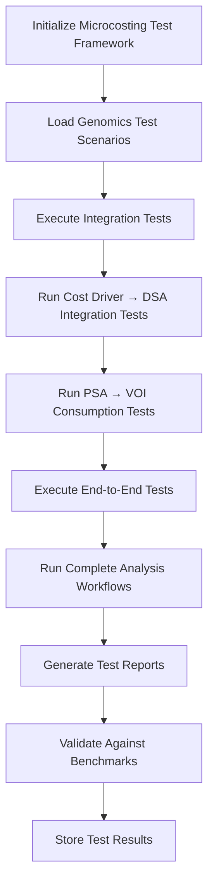
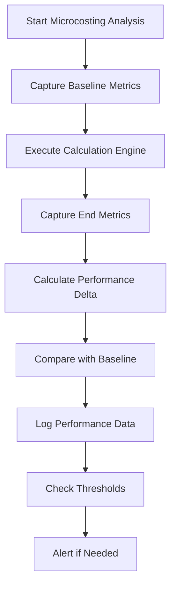
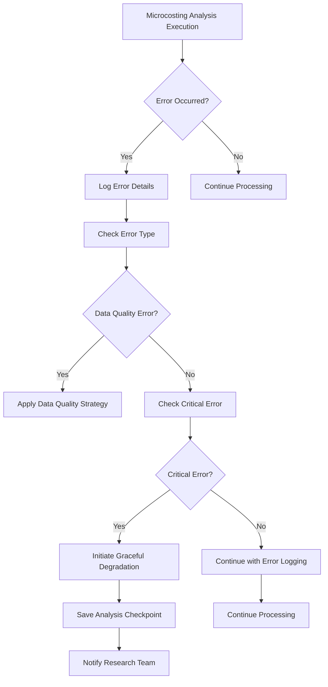
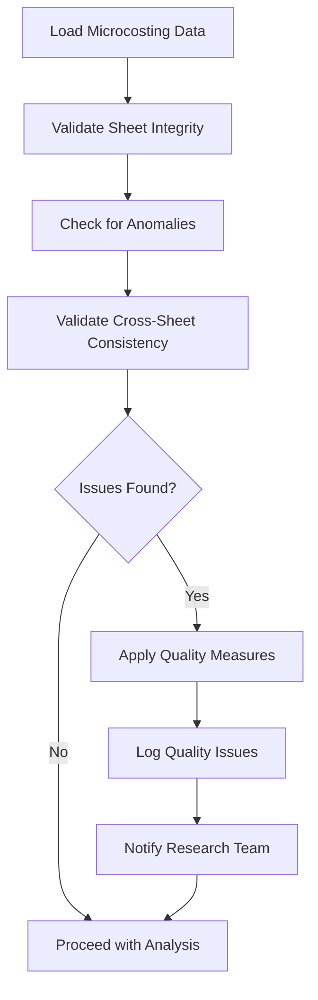

# Genomics Microcosting Project Robustness Improvement Plan Execution

## Overview

This document outlines the execution plan for implementing the robustness improvements in the genomics microcosting project. The improvements focus on strengthening testing, performance, error handling, data quality, configuration management, documentation, security, and monitoring capabilities to ensure the system is production-ready and suitable for academic publication in BMJ Open.

## Architecture

The implementation will follow a modular approach, enhancing existing components while adding new functionality where needed. The architecture will be organized into the following key areas:

1. **Enhanced Testing Framework** - Integration and end-to-end testing capabilities
2. **Performance Benchmarking System** - Monitoring and optimization tools
3. **Error Handling and Recovery** - Comprehensive error management
4. **Data Quality Assurance** - Validation and consistency checks
5. **Configuration Management** - Advanced configuration handling
6. **Security Enhancement** - Access control and data protection
7. **Documentation System** - Comprehensive documentation generation
8. **Monitoring and Observability** - System health and metrics tracking

```mermaid
graph TD
    A[Robustness Improvement Plan] --> B[Testing Enhancement]
    A --> C[Performance Optimization]
    A --> D[Error Handling]
    A --> E[Data Quality]
    A --> F[Configuration Management]
    A --> G[Security Enhancement]
    A --> H[Documentation]
    A --> I[Monitoring]
    
    B --> B1[Integration Tests]
    B --> B2[End-to-End Tests]
    
    C --> C1[Benchmarking]
    C --> C2[Memory Monitoring]
    
    D --> D1[Graceful Degradation]
    D --> D2[Enhanced Logging]
    
    E --> E1[Anomaly Detection]
    E --> E2[Consistency Validation]
    
    F --> F1[Config Validation]
    F --> F2[Environment Support]
    
    G --> G1[Input Sanitization]
    G --> G2[Access Control]
    
    H --> H1[API Docs]
    H --> H2[Tutorials]
    
    I --> I1[Health Checks]
    I --> I2[Metrics Collection]
```



## Implementation Modules

### 1. Enhanced Testing Framework

#### Integration Testing Module
- Create integration test framework using pytest for microcosting modules
- Implement cost driver analysis → DSA (Deterministic Sensitivity Analysis) data flow tests
- Implement PSA (Probabilistic Sensitivity Analysis) results → VOI (Value of Information) analysis consumption tests
- Develop cross-module data consistency validation tests for all analytical modules
- Create test data sets representing various genomics microcosting scenarios

#### End-to-End Testing Module
- Design end-to-end test scenarios for each analysis type (cost driver, DSA, PSA, VOI, etc.)
- Implement workflow tests from raw data loading through calculation engine to report generation
- Create test coverage reports for all analytical modules
- Establish test result validation criteria against known benchmarks

### 2. Performance Benchmarking System

#### Benchmarking Framework
- Develop load testing framework with variable genomics dataset sizes
- Implement memory usage monitoring tools for pandas DataFrame operations
- Create processing time measurement utilities for calculation engine
- Design scalability testing scenarios with increasing numbers of test scenarios
- Establish performance baseline metrics for all analytical modules

### 3. Error Handling and Recovery

#### Comprehensive Error Handling Module
- Implement graceful degradation strategies for missing data sources in microcosting sheets
- Enhance logging with traceable error information using structured logging
- Develop checkpoint/restart capabilities for long-running Monte Carlo simulations
- Add comprehensive input validation for all user inputs and configuration parameters in analysis

### 4. Data Quality Assurance

#### Data Quality Assurance System
- Implement automated data anomaly detection algorithms for cost values
- Develop cross-sheet consistency validation tools for linked data (e.g., labor prices across sheets)
- Create missing data handling strategies for incomplete genomics cost data
- Implement data integrity verification mechanisms for calculated results

### 5. Configuration Management

#### Advanced Configuration Management
- Add configuration parameter validation for analytical parameters
- Implement environment-specific configuration support (development, testing, production)
- Create configuration versioning system for reproducible research
- Develop dynamic configuration update capabilities for scenario modeling

### 6. Security Enhancement

#### Security and Access Control
- Implement input sanitization for all data inputs from Excel sheets
- Develop role-based access control for sensitive genomics cost data
- Create audit trail tracking for data access and modifications in analysis
- Implement secure configuration storage mechanisms for credentials

### 7. Documentation System

#### Comprehensive Documentation Enhancement
- Generate comprehensive API documentation for all microcosting modules
- Create tutorial series for common genomics microcosting analysis workflows
- Develop troubleshooting guides for common data preparation issues
- Write contribution guidelines for framework extension in genomics research

### 8. Monitoring and Observability

#### Monitoring and Observability System
- Implement health check endpoints for system status of analytical modules
- Develop performance metrics collection and reporting for calculation engine
- Create usage analytics tracking for research analysis patterns
- Implement alerting system for critical events in long-running analyses

## Data Models

### Test Data Model
```python
class TestScenario:
    id: str
    name: str
    description: str
    type: str  # integration, end_to_end, performance
    input_data: Dict[str, Any]  # Test data for microcosting analysis
    expected_output: Dict[str, Any]  # Expected results for validation
    execution_time_limit: float  # Maximum allowed execution time
    success_criteria: List[str]  # Criteria to determine test success
```

### Performance Metrics Model
```python
class PerformanceMetrics:
    operation_name: str  # Name of the analytical operation
    execution_time: float  # Time taken for execution in seconds
    memory_usage: float  # Memory usage in MB
    cpu_usage: float  # CPU usage percentage
    data_size: int  # Size of data processed
    timestamp: datetime  # When the metrics were captured
```

### Error Log Model
```python
class ErrorLog:
    id: str  # Unique identifier for the error
    timestamp: datetime  # When the error occurred
    error_type: str  # Type of error (data, calculation, io, etc.)
    error_message: str  # Human-readable error message
    stack_trace: str  # Technical stack trace
    context: Dict[str, Any]  # Context where error occurred
    severity: str  # critical, high, medium, low
    resolved: bool  # Whether the error has been addressed
```

### Configuration Model
```python
class Configuration:
    id: str  # Unique identifier for configuration
    version: str  # Configuration version
    environment: str  # development, testing, production
    parameters: Dict[str, Any]  # Configuration parameters
    validation_rules: Dict[str, str]  # Rules for parameter validation
    created_at: datetime  # When configuration was created
    updated_at: datetime  # When configuration was last updated
```

### Data Quality Model
```python
class DataQualityReport:
    sheet_name: str  # Name of the sheet analyzed
    null_percentage: float  # Percentage of null values
    duplicate_rows: int  # Number of duplicate rows
    anomalies_detected: List[str]  # List of anomalies found
    consistency_issues: List[str]  # Cross-sheet consistency issues
    timestamp: datetime  # When the analysis was performed
```

## Business Logic

### Testing Logic Flow


### Performance Monitoring Flow


### Error Handling Flow


### Data Quality Assurance Flow


## API Endpoints Reference

### Testing API
```
POST /api/microcosting/tests/run
Description: Run specific microcosting test suite
Parameters:
  - test_type: string (integration|end_to_end|performance)
  - analysis_modules: array of strings (optional) [cost_driver, dsa, psa, voi]

GET /api/microcosting/tests/results
Description: Get microcosting test results
Parameters:
  - test_type: string (optional)
  - analysis_module: string (optional)
  - date_range: object (optional)
```

### Performance API
```
GET /api/microcosting/performance/metrics
Description: Get microcosting analysis performance metrics
Parameters:
  - analysis_type: string (optional) [cost_driver, dsa, psa, voi]
  - time_range: object (optional)

POST /api/microcosting/performance/benchmark
Description: Run microcosting benchmark test
Parameters:
  - data_set_size: integer (number of test scenarios)
  - iterations: integer (monte carlo iterations)
```

### Monitoring API
```
GET /api/microcosting/monitoring/health
Description: Get microcosting system health status

GET /api/microcosting/monitoring/metrics
Description: Get microcosting analysis metrics
Parameters:
  - metric_type: string (optional) [memory, cpu, execution_time]

GET /api/microcosting/monitoring/data-quality
Description: Get data quality metrics
Parameters:
  - sheet_name: string (optional)
```

### Data Quality API
```
POST /api/microcosting/data-quality/validate
Description: Run data quality validation
Parameters:
  - sheet_names: array of strings
  - validation_types: array of strings [integrity, consistency, anomalies]

GET /api/microcosting/data-quality/reports
Description: Get data quality reports
Parameters:
  - date_range: object (optional)
```

## Middleware & Interceptors

### Error Handling Middleware
- Global exception handler for microcosting calculations
- Request/response logging for analysis operations
- Performance monitoring interceptor for long-running analyses

### Security Middleware
- Input validation and sanitization for Excel data
- Authentication and authorization for sensitive cost data
- Rate limiting for API endpoints

### Logging Middleware
- Structured logging for reproducible research
- Request tracing for analysis workflows
- Performance logging for calculation engine

### Data Quality Middleware
- Automated anomaly detection for cost values
- Cross-sheet consistency validation
- Data integrity verification before analysis

## Testing Strategy

### Unit Testing
- Test individual functions and methods in microcosting modules
- Mock external dependencies (Excel files, databases)
- Coverage target: >90% for all analytical modules

### Integration Testing
- Test interactions between microcosting analysis modules
- Validate data flow between cost driver, DSA, PSA, and VOI modules
- Test with real genomics cost datasets

### Performance Testing
- Load testing with varying genomics dataset sizes
- Memory and CPU usage monitoring for pandas operations
- Scalability validation for Monte Carlo simulations

### Security Testing
- Input validation testing for Excel data imports
- Access control verification for sensitive cost data
- Data integrity testing for calculation results

### Data Quality Testing
- Automated anomaly detection testing
- Cross-sheet consistency validation testing
- Missing data handling strategy testing

## Implementation Plan

### Phase 1: Enhanced Testing and Performance Benchmarking (Weeks 1-2)
1. Create integration test framework using pytest for microcosting modules
2. Implement cost driver analysis → DSA data flow integration tests
3. Implement PSA results → VOI analysis consumption integration tests
4. Develop cross-module data consistency validation tests for all sheets
5. Create test data sets representing various genomics microcosting scenarios
6. Design end-to-end test scenarios for each analysis type (cost driver, DSA, PSA, VOI)
7. Implement workflow tests from raw Excel data to final reports
8. Develop load testing framework with variable genomics dataset sizes
9. Implement memory usage monitoring tools for pandas DataFrame operations
10. Create processing time measurement utilities for calculation engine
11. Design scalability testing scenarios with increasing test scenarios
12. Establish performance baseline metrics for all analytical modules

### Phase 2: Enhanced Error Handling and Data Quality (Weeks 3-4)
1. Implement graceful degradation strategies for missing data sources in sheets
2. Enhance logging with traceable error information using structured logging
3. Develop checkpoint/restart capabilities for long-running Monte Carlo simulations
4. Add comprehensive input validation for Excel data and configuration parameters
5. Implement automated data anomaly detection algorithms for cost values
6. Develop cross-sheet consistency validation tools for linked data
7. Create missing data handling strategies for incomplete genomics cost data
8. Implement data integrity verification mechanisms for calculated results
9. Create error recovery test scenarios for common failure modes
10. Document error handling procedures for research reproducibility

### Phase 3: Configuration Management and Security (Weeks 5-6)
1. Add configuration parameter validation for all analytical parameters
2. Implement environment-specific configuration support (dev/test/production)
3. Create configuration versioning system for reproducible research
4. Develop dynamic configuration update capabilities for scenario modeling
5. Implement input sanitization for all Excel data inputs
6. Develop role-based access control for sensitive genomics cost data
7. Create audit trail tracking system for data access and modifications
8. Implement secure configuration storage mechanisms for credentials
9. Document configuration management and security procedures

### Phase 4: Documentation and Monitoring (Weeks 7-8)
1. Generate comprehensive API documentation for all microcosting modules
2. Create tutorial series for common genomics microcosting analysis workflows
3. Develop troubleshooting guides for common data preparation issues
4. Write contribution guidelines for framework extension in genomics research
5. Ensure BMJ Open compliance for all technical documentation
6. Implement system health check endpoints for analytical modules
7. Develop performance metrics collection for calculation engine
8. Create usage analytics tracking for research analysis patterns
9. Implement alerting system for critical events in long-running analyses
10. Document monitoring procedures for ongoing system maintenance